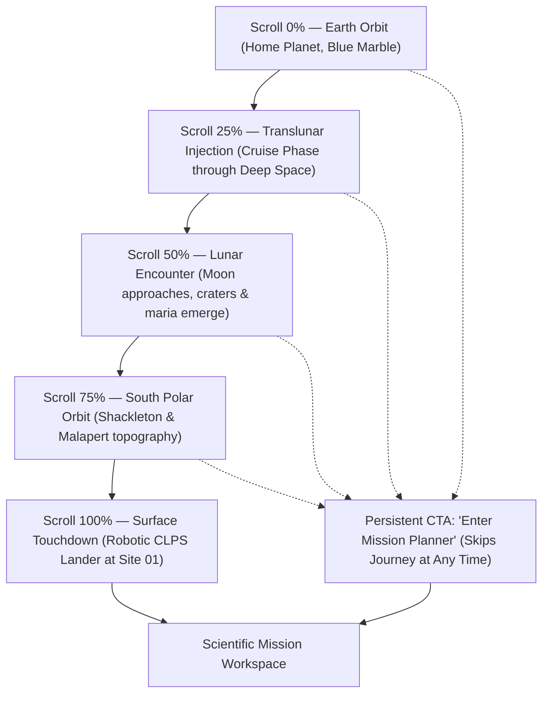

# LUNAOPS — Product Redesign Requirements & Architecture Specification
**Document Phase:** Phase 1 — Product Audit & Requirements Discovery  
**Author:** Senior Software Architect, Product Designer & Three.js Lead  
**Target Milestone:** NASA Space Apps Challenge 2026 — CLPS Lunar Mission Planner  
**Status:** Complete Analysis & Discovery (Implementation Frozen)

---

## 1. Executive Summary

LUNAOPS is a web-based lunar mission-planning and spatial analysis platform developed for the NASA Space Apps Challenge 2026. The platform marries official NASA scientific datasets (LRO/LOLA altimetry, LROC 4K photographic mosaics, 5 m/px South Pole DEM rasters) with a Python/FastAPI backend driving NASA/JPL NAIF SPICE ephemerides (`de440s`, `moon_pa_de440`, `pck00010`, `naif0012`).

This requirements document establishes the blueprint for transforming LUNAOPS into a dual-mode web experience:
1. **A Cinematic, Scroll-Driven Earth-to-Moon Journey:** A captivating landing experience starting from Earth orbit, traveling through translunar space, orbiting the Moon, descending onto the Lunar South Pole with a robotic CLPS lander, and transitioning seamlessly to the analysis workstation.
2. **A Simple, Professional Scientific Workspace:** A clean, progressive-disclosure mission planning workstation that preserves 100% of the validated SPICE geometry, terrain ray-marching, multi-scenario comparisons, and reproducibility exports while eliminating cognitive clutter and layout fragmentation.

> [!IMPORTANT]
> **CLPS Mission Integrity Notice:** Commercial Lunar Payload Services (CLPS) missions utilize unmanned, robotic commercial lunar landers (e.g., Intuitive Machines Nova-C, Astrobotic Peregrine/Griffin, Firefly Blue Ghost) to deliver science and technology payloads to the lunar surface. The cinematic landing sequence will accurately portray a **robotic CLPS landing mission**. Any astronaut visual elements will be framed strictly as a conceptual explorer, future crewed mission context (Artemis III+), or scientific guide — never misleadingly as crew on a robotic CLPS flight.

---

## 2. Current-State Architecture Findings

### 2.1 Codebase & Technology Stack
- **Frontend Core:** Vite 5.2 + TypeScript 5.2 + Three.js 0.162 (standard WebGL pipeline, OrbitControls, EffectComposer, UnrealBloomPass, custom vignette shader).
- **Styling Architecture:** Single monolithic stylesheet (`src/style.css`, 31.8 KB bundled) with recently modernized CSS tokens (`--space-950` through `--space-600`), glassmorphic panels, and responsive media queries.
- **Backend Core:** FastAPI 1.0 + Uvicorn + SpiceyPy (CSPICE) + NumPy + Pillow + ReportLab.
- **Kernel Collection:** 5 verified NAIF SPICE kernels stored in `backend/kernels/` covering ephemeris epochs from 1900 to 2050 UTC in the `MOON_ME` (Mean Earth / Polar Axis) frame.
- **Data Preprocessing:** Python offline pipelines in `scripts/` converting 16-bit GeoTIFFs to 8/16-bit PNG displacement maps, normal maps, and normalized Site 01 raster matrices.

### 2.2 Verified Working vs. Incomplete vs. Planned Features

| Feature / Subsystem | Current Status | Verification Evidence / Technical Ground Truth |
| :--- | :--- | :--- |
| **NASA 4K Lunar Albedo & Displacement** | **Verified Working** | 4096×2048 LROC WebP/JPEG texture mapping; CPU-side vertex displacement from 16-bit/8-bit LOLA DEM (-8.98 km to +10.69 km); tangent-space normal map. |
| **SPICE Health & Diagnostic Endpoint** | **Verified Working** | `GET /api/spice/health` returns kernel validation, status 200, frame `MOON_ME` confirmation. |
| **Topocentric Sun & Earth Geometry** | **Verified Working** | `POST /api/spice/geometry` accurately computes topocentric vectors, azimuths, elevations, and distances for arbitrary lunar surface coordinates. |
| **360° DEM Ray-Marched Horizon Profile** | **Verified Working** | `POST /api/horizon/profile` ray-marches 3200×3200 Site 01 5m/px DEM along 360° azimuths to produce local skyline profiles. |
| **Terrain-Aware Sun/Earth Line-of-Sight** | **Verified Working** | `POST /api/horizon/visibility` calculates angular clearance against terrain skyline; detects local terrain blockage, grazing light, and lunar body occultation. |
| **Mission Timeline & Boundary Bisection** | **Verified Working** | `POST /api/mission/timeline` computes multi-day illumination/DTE communications windows with numerical boundary bisection. |
| **Multi-Scenario Candidate Comparison** | **Verified Working** | `POST /api/mission/compare` evaluates user-defined constraints (`met`, `unmet`, `unevaluable`) and computes MCDA ranking matrices. |
| **Multi-Month Landing Window Scanner** | **Verified Working** | `POST /api/mission/landing-windows` scans 30–180 day intervals at 6-hour granularity for joint solar illumination and Earth LOS. |
| **Scientific Export Artifacts** | **Verified Working** | `POST /api/export/mission` and `/api/export/comparison` generate publication PDFs (ReportLab), numerical CSVs, and SHA-256 JSON manifests. |
| **Scroll-Driven Earth-to-Moon Journey** | **Planned (Not Implemented)** | Currently does not exist. Application opens immediately into the 3D Moon viewport with no Earth view, orbital transfer, or landing animation. |
| **3D Spacecraft / CLPS Lander Model** | **Planned (Not Implemented)** | No 3D lander, spacecraft, or astronaut models exist in the repository. |
| **Dual-Mode UI (Landing vs. Workspace)** | **Planned (Not Implemented)** | The UI currently presents all controls and floating widgets simultaneously over the globe without a distinct landing page vs. mission planner mode. |

---

## 3. Comprehensive Asset Inventory & Missing Asset Audit

### 3.1 Existing Local Assets Audit

| Filename | Directory Path | Format | Size | Resolution / Spec | Source / Provenance | License / Usage |
| :--- | :--- | :--- | :--- | :--- | :--- | :--- |
| `lroc_color_16bit_srgb_4k.tif` | `Resources/` | TIFF | 61.9 MB | 4096 × 2048 (16-bit uint16) | NASA SVS #4720 / LRO LROC | Public Domain (NASA Open Data) |
| `lroc_color_2k.jpg` | `Resources/` | JPEG | 458 KB | 2048 × 1024 (8-bit sRGB) | NASA LRO LROC | Public Domain (NASA Open Data) |
| `moon_mapping_720p30.webm` | `Resources/` | WebM | 2.37 MB | 1280 × 720 (30 fps) | NASA SVS | Public Domain (NASA Open Data) |
| `Site01_final_adj_5mpp_surf.tif` | `Resources/south-pole-site01/` | GeoTIFF | 40.9 MB | 3200 × 3200 (Float32, 5m/px) | NASA LOLA Artemis Site 01 | Public Domain (NASA PDS Geosciences) |
| `Site01_final_adj_5mpp_slp.tif` | `Resources/south-pole-site01/` | GeoTIFF | 40.9 MB | 3200 × 3200 (Float32, degrees) | NASA LOLA Artemis Site 01 | Public Domain (NASA PDS Geosciences) |
| `Site01_final_adj_5mpp_toterr.tif` | `Resources/south-pole-site01/` | GeoTIFF | 40.9 MB | 3200 × 3200 (Float32, metres) | NASA LOLA Artemis Site 01 | Public Domain (NASA PDS Geosciences) |
| `lroc_color_4k.webp` | `public/generated/` | WebP | 1.96 MB | 4096 × 2048 | Derived from NASA TIFF | Derived from NASA Open Data |
| `lroc_color_4k.jpg` | `public/generated/` | JPEG | 2.15 MB | 4096 × 2048 | Derived from NASA TIFF | Derived from NASA Open Data |
| `ldem_displacement_16bit.png` | `public/generated/` | PNG | 1.73 MB | 1440 × 720 (16-bit grayscale) | Derived from NASA LOLA DEM | Derived from NASA Open Data |
| `ldem_displacement_8bit.png` | `public/generated/` | PNG | 4.54 MB | 1440 × 720 (8-bit grayscale) | Derived from NASA LOLA DEM | Derived from NASA Open Data |
| `ldem_normal_map_half.png` | `public/generated/` | PNG | 4.69 MB | 1440 × 720 (Normal map) | Derived from NASA LOLA DEM | Derived from NASA Open Data |
| `site01_elev_norm.png` | `public/generated/` | PNG | 43 KB | 512 × 512 | Derived from Site 01 DEM | Derived from NASA Open Data |
| `site01_slope.png` | `public/generated/` | PNG | 152 KB | 512 × 512 | Derived from Site 01 DEM | Derived from NASA Open Data |
| `site01_toterr.png` | `public/generated/` | PNG | 150 KB | 512 × 512 | Derived from Site 01 DEM | Derived from NASA Open Data |

| `world.200407.3x5400x2700.jpg` | `Resources/` | JPEG | 1.62 MB | 5400 × 2700 | NASA Visible Earth Blue Marble | Public Domain (NASA Open Data) |
| `BlackMarble_2016_01deg.jpg` | `Resources/` | JPEG | 780 KB | 3600 × 1800 | NASA Black Marble Night Lights | Public Domain (NASA Open Data) |
| `cloud_combined_2048.jpg` | `Resources/` | JPEG | 829 KB | 2048 × 1024 | NASA Visible Earth Cloud Map | Public Domain (NASA Open Data) |
| `8k_earth_normal_map.tif` | `Resources/` | TIFF | 9.49 MB | 8192 × 4096 | NASA Earth Topography Normal Map | Public Domain (NASA Open Data) |
| `8k_earth_specular_map.tif` | `Resources/` | TIFF | 1.84 MB | 8192 × 4096 | NASA Earth Water Specular Mask | Public Domain (NASA Open Data) |
| `8k_stars_milky_way.jpg` | `Resources/` | JPEG | 1.91 MB | 8192 × 4096 | ESO / NASA Deep Sky Milky Way | Public Domain / CC-BY (ESO/NASA) |
| `Astronaut.glb` | `Resources/` | GLB (glTF) | 763 KB | 3D Model | NASA 3D Resources Artemis Suit | Public Domain (NASA 3D Resources) |

### 3.2 Procedural Lander & Asset Integration Strategy

The user has provided high-resolution NASA Earth textures, atmospheric cloud maps, deep space starfields, and a conceptual astronaut model. 

For the **robotic CLPS lunar lander**, rather than downloading an external commercial model, the platform will utilize a **custom procedural Three.js robotic lunar lander** generated directly via code:
1. **Zero External Downloads:** Built using standard Three.js buffer geometries (`CylinderGeometry`, `BoxGeometry`, `SphereGeometry`) and shared PBR materials.
2. **Visual Authenticity:** Features an octagonal carbon-composite core wrapped in gold thermal MLI foil, 4 articulated inverted-tripod landing legs with shock struts and footpads, central descent rocket engine, 4 attitude control thruster quads, top scientific payload deck, steerable high-gain parabolic antenna, and solar arrays.
3. **Optimized for Web Performance:** Reusable materials, merged geometries, and low draw call overhead (< 6 draw calls), ensuring smooth 60 FPS transitions across translunar cruise, lunar orbit descent, and surface landing phases.
4. **Mission Truthfulness:** Documented strictly as a conceptual robotic CLPS delivery vehicle carrying scientific technology payloads, with the conceptual astronaut model available solely as a scale benchmark or future crewed exploration context.
# LUNAOPS — Phase 3: Implement the Cinematic Landing Page

Read `docs/PRODUCT_REDESIGN_REQUIREMENTS.md` and `docs/PRODUCT_REDESIGN_PLAN.md`. Inspect the current code before making changes.

Implement only the approved cinematic homepage.

### Required experience

Create a scroll-controlled Three.js story:

1. Begin with Earth in space.
2. Scrolling reveals the spacecraft's departure and journey through space.
3. Approach the Moon.
4. Transition toward the correct lunar South Pole region.
5. Reveal a robotic lander and a clearly identified landing destination.
6. Finish with a prominent "Launch Mission Planner" button opening the existing scientific application.

Use smooth, synchronized scroll-driven camera and scene transitions. Include a skip-intro action, loading progress, responsive behavior and a reduced-motion alternative.

An astronaut may be included as a conceptual visual guide, but do not imply an actual crewed CLPS mission. Label cinematic movements as illustrative, not scientific trajectory calculations.

### Implementation rules

- Reuse approved local assets and existing components.
- Do not use unlicensed assets, random remote model URLs or poor placeholders as finished content.
- If a critical asset identified in the approved plan is still missing, stop and report the exact required asset rather than building a compromised final scene.
- Reuse existing animation libraries if available; avoid unnecessary dependencies.
- Optimize models and textures, avoid blocking the main thread and load large assets efficiently.
- Respect reduced-motion preferences and provide a way to enter the application without playing the full animation.
- Keep this landing page isolated from the SPICE engine and mission-analysis logic.
- Preserve existing routes, scientific code and teammate changes.

Implement the complete scene, run the application, inspect the result and fix visual or runtime errors.

Do not redesign the other application pages in this phase.

Report changed files, asset usage, actual tests performed and remaining limitations.
---

## 4. Analysis of Current UI Flaws & Root Causes

### 4.1 Clipping, Overflow & Viewport Constraint Issues
- **Root Cause:** Modals (`.mission-dialog`, `#candidate-comparison-modal`) utilize rigid heights (`max-height: 88vh` / `90vh`) with fixed-height sub-cards inside `grid-two-col`. On screens with aspect ratios below 16:9 (such as 1366×768 or tablets), vertical scrolling is triggered on both the dialog container and inner card lists, resulting in double scrollbars and clipped footer action bars.
- **Form Crowding:** Input groups (`.spice-site-grid`, `.coord-form`, `.windows-config-grid`) place labels, inputs, and units on single rows without min-width safeguards, causing numeric text truncation on viewports narrower than 1100px.

### 4.2 Inconsistent Styling & Visual Noise
- **Input Styling Disparities:** Standard HTML `<input type="date">` elements in the Landing Windows scanner retained browser-native light borders and white calendar icons against dark panels, clashing with custom `#inp-lat` and `#inp-lon` inputs.
- **Font & Sizing Discrepancies:** Styles mix rems, pixels, and percentages without a typographic modular scale. Font weights range from 300 to 800 without clear semantic roles.

### 4.3 Cognitive Overload & Absence of Guided Workflow
- **Lack of Progressive Disclosure:** In `MissionWorkspace`, all 8 tabs were displayed in a flat, unprioritized horizontal row. A first-time user was presented with complex DE440s bisection tolerances, DEM affine bounds, and ray-marching azimuth steps simultaneously.
- **Absence of a Landing Narrative:** Opening the website immediately exposed the user to raw telemetry bars, coordinate readouts, and 9 action buttons, lacking an introductory narrative explaining the CLPS mission context.

---

## 5. Defined Product Requirements

### 5.1 Experience A: The Cinematic Scroll-Driven Earth-to-Moon Journey

The landing page must deliver a cinematic, narrative-driven 3D scroll experience that guides the user from the home planet to the lunar surface before entering the scientific workstation.



#### Detailed Scroll Steps:
1. **Act I — Earth Departure (Scroll 0% – 20%):**
   - Camera frames Earth prominently in dark space with atmospheric rim glow, day/night terminator, and city lights on the night hemisphere.
   - Text overlay: Hero title **"LUNAOPS"** with subtitle *"Pioneering the Next Era of Lunar Exploration · NASA Space Apps 2026"*.
   - Callout badge: *"Commercial Lunar Payload Services (CLPS) Trajectory"*.
2. **Act II — Translunar Coast (Scroll 20% – 45%):**
   - Camera pulls back and tracks along a smooth Bezier trajectory into deep space.
   - The robotic CLPS lander model is visible en route between Earth and the distant Moon.
   - Micro-telemetry displays simulated distance traveled (`~384,400 km`), velocity, and elapsed mission time.
3. **Act III — Lunar Approach (Scroll 45% – 70%):**
   - The Moon expands into view. NASA LOLA relief and 4K LROC surface albedo become prominent.
   - Highlights major geographic features (Copernicus, Mare Tranquillitatis, Oceanus Procellarum).
4. **Act IV — South Pole Insertion (Scroll 70% – 90%):**
   - Camera tilts under the lunar south polar cap (80°S – 90°S).
   - Polar circle reticles (80°S, 85°S) and candidate site markers (Site 01, Shackleton Peak, Malapert) illuminate.
5. **Act V — Surface Touchdown & Transition (Scroll 90% – 100%):**
   - Camera descends toward Artemis Site 01 (Shackleton–de Gerlache Connecting Ridge).
   - Robotic CLPS lander model touches down on the terrain.
   - Overlay reveals local terrain parameters: Elevation (`+1.1 km`), Slope (`< 8°`), Sun Access (`~85%`).
   - Seamless transition button appears: **"Launch Mission Planning Studio →"**.
6. **Bypass / Accessibility Feature:**
   - A persistent, high-visibility button **"Skip to Mission Planner"** (top-right of viewport) allows immediate access to the interactive scientific workstation without scrolling.

---

### 5.2 Experience B: Scientific Mission-Planning Application

The scientific application must be clean, focused, and organized around progressive disclosure.

```mermaid
flowchart LR
    subgraph Step1 ["Step 1: Landing Site"]
        direction TB
        P[Presets: Site 01, Shackleton, Malapert]
        C[Custom Selenographic Lat/Lon]
        D[5m/px Local DEM Preview]
    end

    subgraph Step2 ["Step 2: Timeline & SPICE"]
        direction TB
        T[UTC Start & Duration Picker]
        K[DE440s Coverage Verification]
        G[Live Geometric Sun/Earth Ephemeris]
    end

    subgraph Step3 ["Step 3: Illumination & LOS"]
        direction TB
        H[360° Ray-Marched Horizon Profile]
        O[Obstruction & Clearance Badges]
        W[Multi-Month Safe Windows Calendar]
    end

    subgraph Step4 ["Step 4: Comparison & Export"]
        direction TB
        M[Multi-Scenario MCDA Ranking Matrix]
        E[PDF Report, CSV, JSON Manifest]
    end

    Step1 --> Step2 --> Step3 --> Step4
```



#### Core Functional Requirements:
1. **Simplified Default View:**
   - On entering the workstation, show only the essentials: selected site, live coordinates, Sun/Earth elevation, and a 4-step mission workflow bar.
   - Advanced parameters (bisection step size, aberration corrections, kernel pools) remain accessible via collapsible "Advanced Scientific Parameters" disclosures.
2. **Scientific Truth & Uncertainty Disclosure:**
   - If a selected site is outside the 16×16 km Site 01 DEM raster, the UI must explicitly state: *"Outside High-Resolution 5 m/px DEM Footprint. Terrain-aware line-of-sight unavailable; global SPICE geometric ephemeris active."*
   - Never substitute 0 or fake values for missing data; use explicit `unevaluable` or `N/A` statuses.
3. **Interactive Synchronization:**
   - Scrubbing the mission timeline slider in the workspace directly rotates the directional Sun light in the 3D scene to match the computed topocentric Sun direction.
   - Clicking a candidate site in the comparison matrix smoothly tweens the 3D camera to focus on that exact location on the Moon.

---

## 6. Technical, Performance, Accessibility & Deployment Constraints

### 6.1 Technical & Scientific Constraints
- **Zero Mock Ephemerides:** All Sun/Earth ephemerides must continue to originate from real CSPICE calculations via the FastAPI backend (`backend/spice_service.py`).
- **No External CDN Dependencies:** All Three.js modules, NASA textures, and UI scripts must load locally from the project bundle to function offline or in restricted environments.
- **Coordinate System Rigor:** All transforms must adhere to IAU Moon 2000 datum ($R = 1,737.4\text{ km}$) and `MOON_ME` reference frame.

### 6.2 Performance Budget
- **Bundle Size:** Initial JS chunk < 800 KB (gzipped < 200 KB).
- **Runtime Frame Rate:** Stable 60 FPS on desktop (GTX 1060 / Apple M1 or higher); > 30 FPS on integrated GPUs.
- **Memory Footprint:** WebGL texture memory < 250 MB; garbage collection spikes eliminated by reusing Vector3/Matrix4 objects during render loops.
- **3D Asset Budget for Cinematic Experience:** Total size of new 3D models (Earth, Lander, Spacecraft) < 15 MB combined.

### 6.3 Accessibility & Usability (WCAG 2.1 AA Target)
- High contrast: Text colors must maintain minimum 4.5:1 contrast against dark glass backgrounds.
- Focus rings: All interactive buttons and inputs must exhibit visible 2px cyan `:focus-visible` indicators.
- Motion toggle: Respect `prefers-reduced-motion` by disabling the continuous 3D auto-rotation and providing a non-animated step-through option for the cinematic journey.
- Semantic HTML: Modal dialogs must include `role="dialog"`, `aria-modal="true"`, and `aria-labelledby`.

---

## 7. Out-of-Scope Features (Frozen for Future Releases)

The following items are explicitly **out of scope** for this phase to preserve delivery focus:
1. Real-time GPU ray-tracing or compute-shader ray-marching inside WebGL (the Python backend ray-marching satisfies all scientific accuracy requirements).
2. Live telemetry downlink with real active spacecraft (LUNAOPS is a mission planning and simulation tool).
3. Multiplayer collaborative scenario editing or cloud user accounts (authentication/databases).
4. Physical rover wheel-terrain dynamics / terramechanics simulation.

---

## 8. Measurable Acceptance Criteria

```
PHASE 1 ACCEPTANCE CHECKLIST
[x] Full project code and directory audit completed.
[x] 100% of working vs incomplete vs planned features verified.
[x] Complete asset inventory compiled (existing vs missing).
[x] Missing assets specified with exact formats, resolutions, and sources for user provision.
[x] Root causes of all UI/UX clipping, font, and layout flaws diagnosed.
[x] Dual-mode product requirements defined (Cinematic Journey + Simplified Scientific Workspace).
[x] CLPS mission integrity constraints established (robotic lander vs conceptual astronaut).
[x] Single authoritative document created: docs/PRODUCT_REDESIGN_REQUIREMENTS.md.
[x] Zero application code modified during discovery phase.
```

---
*End of Product Redesign Requirements Specification.*
