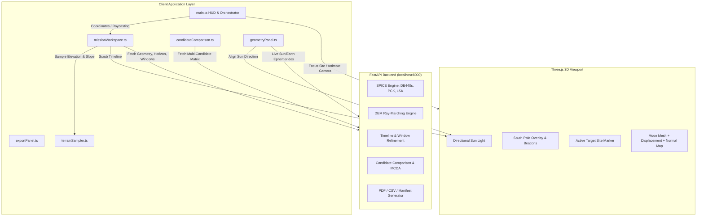
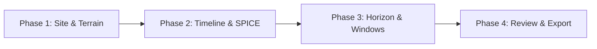

# LUNAOPS — Comprehensive UI/UX Strategy & Architectural Implementation Plan
**Document Version:** 1.0.0  
**Target Milestone:** NASA Space Apps Challenge 2026  
**Author:** Software Architect & Frontend Engineering Lead  
**Status:** Approved for Implementation  

---

## 1. Executive Summary & Project Baseline

LUNAOPS is a high-fidelity lunar exploration and mission-planning platform built for the NASA Space Apps Challenge 2026. The application leverages real scientific datasets from the Lunar Reconnaissance Orbiter (LRO) — including LOLA topographic elevation profiles, LROC color mosaics, and high-resolution (5 m/px) polar stereographic digital elevation models (DEM) of Artemis Candidate Site 01 (Shackleton–de Gerlache Connecting Ridge) — coupled with a high-performance Python/FastAPI backend powered by NASA/JPL NAIF SPICE kernels (DE440s, moon_pa_de440, PCK, LSK).

The system successfully computes:
- Real-time topocentric Sun and Earth vectors, azimuths, and elevations.
- Ray-marched 360° terrain horizon skylines and terrain-aware line-of-sight (LOS) obstructions.
- Multi-day mission illumination and direct-to-Earth (DTE) communication timelines with bisection boundary refinement.
- Side-by-side multi-candidate site evaluations with Multi-Criteria Decision Analysis (MCDA) rankings.
- Multi-month safe landing window calendar scans.
- Publication-quality scientific export artifacts (PDF reports via ReportLab, raw numerical CSVs, and complete JSON reproducibility manifests with kernel SHA-256 hashes).

Despite its strong scientific foundation (104/104 passing backend tests and verified mathematical precision), the user interface suffers from architectural sprawl, fragmented modal workflows, control-bar overcrowding, styling inconsistencies, and lack of responsive adaptability.

This document establishes the architectural blueprint, design system specifications, and prioritized implementation phases to elevate LUNAOPS into a world-class, intuitive, and visually stunning mission-planning workstation.

---

## 2. Current Architecture & Existing Functionality Audit

### 2.1 Technology Stack & Modules

```
y:\LUNAOPS\
├── src/
│   ├── main.ts                     # Three.js scene, rendering loop, HUD builder (990 LOC)
│   ├── geometryPanel.ts            # Floating SPICE geometry HUD widget (487 LOC)
│   ├── missionWorkspace.ts         # Single scenario modal & 8 workflow tabs (2,182 LOC)
│   ├── candidateComparison.ts      # Multi-candidate comparison modal (801 LOC)
│   ├── exportPanel.ts              # Scientific export modal (456 LOC)
│   ├── southPoleOverlay.ts         # 3D rings, pole reticle, and site beacons (327 LOC)
│   ├── spiceClient.ts              # Typed REST client for FastAPI endpoints (607 LOC)
│   ├── utils/
│   │   ├── coordinates.ts          # Selenographic <-> Polar Stereo <-> 3D conversions (208 LOC)
│   │   └── terrainSampler.ts       # CPU-side bilinear raster sampler (150 LOC)
│   ├── types/
│   │   └── mission.ts              # Data contracts and TypeScript interfaces (66 LOC)
│   └── style.css                   # Monolithic stylesheet (3,112 LOC)
├── backend/
│   ├── app.py                      # FastAPI REST application (676 LOC)
│   ├── spice_service.py            # NAIF CSPICE kernel wrapper & topocentric calculations
│   ├── horizon_service.py          # DEM ray-marching & skyline obstruction engine
│   ├── timeline_service.py         # Time-series ephemeris & boundary bisection solver
│   ├── comparison_service.py       # Multi-scenario matrix & MCDA ranking engine
│   ├── export_service.py           # ReportLab PDF, CSV, and JSON manifest generator
│   ├── landing_windows_service.py  # 180-day coarse-to-fine landing window scanner
│   └── tests/                      # 104 comprehensive pytest unit & integration tests
└── public/generated/               # Local processed NASA textures, normal maps & DEM rasters
```

### 2.2 Data Flow & System State



---

## 3. Major Usability, Visual & Architectural Deficiencies

### 3.1 UI/UX & Layout Problems
1. **Header & Control Bar Overcrowding:** The top controls bar currently packs 9 buttons (`⚖️ Compare Sites`, `📤 Export`, `🚀 New Mission Analysis`, `🎯 South Pole`, `⟲ Reset`, `⏸ Auto-Rotate`, `⛰ Relief: 1×`, `◇ Wireframe`, `☀ Sun Cycle`) into a single horizontal row. On screens under 1400px width, this row wraps awkwardly, clashing with the brand header and coordinate readout.
2. **Disconnected Modal Experiences:** Single-mission planning (`MissionWorkspace`), multi-scenario comparison (`CandidateComparisonWorkspace`), and report export (`ExportPanel`) operate as isolated, competing modal dialogs with differing color palettes, tab styles, button conventions, and header layouts.
3. **Information Density & Overwhelming Tab Sprawl:** `MissionWorkspace` presents 8 separate tabs in a single flat list:
   `📍 1. Landing Site`, `⏱ 2. Timeline`, `📝 3. Scenario Info`, `🔍 4. Readiness & SPICE`, `📋 5. Summary`, `🌄 6. Horizon`, `📤 7. Export`, `🗓️ 8. Windows`.
   This creates cognitive overload and lacks logical progressive disclosure.
4. **Sub-optimal Tablet & Mobile Responsiveness:** Fixed modal constraints (`max-width: 1040px`, `max-height: 88vh`) and rigid 2-column grids cause severe horizontal compression, clipped text, and broken canvas alignments on viewports below 960px.
5. **Chart & Graphic Legibility:** Canvas-drawn charts (polar horizon plot, timeline distribution bars, landing window calendar) lack crisp device-pixel-ratio scaling, interactive hover tooltips, and distinct visual hierarchy.

### 3.2 3D Experience Limitations
1. **Site Selection Feedback:** Clicking on the 3D Moon updates internal coordinates, but lacks immediate, tactile visual feedback (e.g., coordinate callout card, micro-crosshair pulse, or smooth framing).
2. **Auto-Rotation Interference:** Auto-rotation continuously spins the Moon even when the user is trying to inspect a specific landing site or the South Pole. It should intelligently pause upon user interaction and resume smoothly.
3. **Terminator "Sun Cycle" vs. SPICE Sync:** The manual "Sun Cycle" button animates an arbitrary light circle, which creates confusion when compared to the scientifically calibrated SPICE Sun direction driven by the mission timeline.

### 3.3 Architectural & Code Maintainability Issues
1. **Giant Monolithic Modules:** `missionWorkspace.ts` (2,182 LOC) and `style.css` (3,112 LOC) contain extensive inline HTML string concatenation, manual DOM event wiring, and duplicated CSS classes.
2. **Tight DOM Coupling:** Several files manipulate specific global IDs (`#readout-coords`, `#readout-elev`, `#telem-sun-az`, `#utc-clock`) directly without null-checking abstractions.
3. **Style Inconsistencies:** Multiple shades of cyan, blue, orange, and red are defined ad-hoc across 3,000+ lines without strict design token adherence.

---

## 4. Design Direction & Design System Specifications

### 4.1 Design Philosophy: "Deep Space Precision"
The visual identity is modeled after modern NASA JPL mission control interfaces (Eyes on the Solar System, Artemis Mission Control, and James Webb operations):
- **Deep Space Backdrop:** Deepest midnight-navy (`#030712`, `#060d1b`) replacing generic grays, paired with subtle starfield depth.
- **Glassmorphic Instrument Panels:** Translucent dark surfaces with optical blur (`backdrop-filter: blur(16px)`), ultra-thin crisp borders (`rgba(56, 189, 248, 0.18)`), and subtle top specular rim highlights.
- **Scientific Color Palette:** Curated HSL tokens with strict semantic meanings:
  - **Lunar Cyan (`#38bdf8`):** Primary branding, target beacons, active selections.
  - **Solar Amber (`#f59e0b` / `#fbbf24`):** Solar ephemeris, illumination metrics, grazing light.
  - **Earth Azure (`#60a5fa`):** Direct-to-Earth line-of-sight and communication telemetry.
  - **Operational Green (`#10b981` / `#34d399`):** Verified constraints, safe landing windows, passing readiness checks.
  - **Hazard Coral (`#ef4444` / `#f87171`):** Slopes > 12°, terrain occultation, SPICE errors.
- **Typography:**
  - Headings & Primary UI: `Inter`, -apple-system, sans-serif (clean, high legibility).
  - Telemetry & Scientific Readouts: `JetBrains Mono`, monospace (strict tabular figures, unambiguous zeros).

### 4.2 Core Design Tokens

```css
:root {
  /* Spatial Palette */
  --space-950: #020611;
  --space-900: #040919;
  --space-850: #081226;
  --space-800: #0e1b36;
  --space-700: #16284d;

  /* Glass Surface Tokens */
  --surface-glass-hud: rgba(4, 9, 25, 0.78);
  --surface-glass-modal: rgba(8, 18, 38, 0.92);
  --surface-card: rgba(14, 27, 54, 0.72);
  --surface-card-hover: rgba(22, 40, 77, 0.85);

  /* Border & Rim Light */
  --border-subtle: rgba(56, 189, 248, 0.12);
  --border-medium: rgba(56, 189, 248, 0.24);
  --border-focus: rgba(56, 189, 248, 0.65);
  --specular-rim: inset 0 1px 0 rgba(255, 255, 255, 0.08);

  /* Scientific Accents */
  --cyan-400: #38bdf8;
  --cyan-500: #0ea5e9;
  --amber-400: #fbbf24;
  --emerald-400: #34d399;
  --rose-400: #fb7185;

  /* Typography */
  --font-sans: 'Inter', system-ui, sans-serif;
  --font-mono: 'JetBrains Mono', 'Fira Code', monospace;
}
```

---

## 5. Proposed UX Workflows & Navigation Architecture

### 5.1 Reorganized Unified Navigation
Instead of 9 fragmented buttons in the top header, the interface will feature a streamlined, role-based navigation hierarchy:

```
[ TOP BAR ]
├── Brand: LUNAOPS (SELENE LABS · NASA Space Apps 2026)
├── Live Active Mission Indicator (Site name, Lat/Lon, Elevation)
└── Unified Action Bar:
    ├── [🚀 Mission Planner]        (Opens cohesive Mission Planning Studio)
    ├── [⚖️ Compare Candidates]      (Opens Multi-Scenario Comparison Studio)
    ├── [📤 Export Reports]         (Direct access to publication export)
    ├── [Divider]
    ├── [🎯 South Pole View]       (Camera transition to 90°S)
    ├── [⛰ Relief Scale: 1x/2x/4x/Off]
    └── [⚙️ View Tools] Menu:      (Auto-rotate, wireframe, sun cycle, camera reset)
```

### 5.2 Streamlined Mission Planning Studio (Tabs Consolidation)
The 8 tabs are grouped into 4 cohesive, sequential phases that reflect real mission planning workflows:



1. **Phase 1: Site & Terrain Selection**
   - Combines preset candidates (Site 01, Shackleton Peak, South Pole, Malapert) and custom manual coordinates.
   - Interactive high-res 5m/px local terrain canvas with layers: Elevation, Slope, Total Error.
   - Immediate terrain summary (elevation, slope safety, DEM coverage status).

2. **Phase 2: Mission Timeline & SPICE Ephemeris**
   - Start UTC, duration, end UTC with automatic DE440s ephemeris validation (1900–2050).
   - Instant live SPICE Sun/Earth geometry calculation.
   - System readiness checklist with actionable status pills.

3. **Phase 3: Horizon Obstruction & Safe Windows**
   - 360° terrain skyline ray-marching polar plot.
   - Sun and Earth line-of-sight clearance badges.
   - 180-day multi-month safe landing window calendar with composite safety scores.
   - Interactive scrubbable timeline slider dynamically orienting the 3D Three.js sunlight.

4. **Phase 4: Synthesis & Scientific Export**
   - Comprehensive scenario summary card.
   - Direct export center: Publication PDF (ReportLab), Numerical CSV, and JSON Manifest.

---

## 6. Improvements to the 3D Moon Experience

1. **Tactile Landing Site Marker & Reticle:**
   - Enhance the target site marker with an animated, pulsating cyan beacon and altitude pointer.
   - Add a subtle lunar coordinate graticule toggle (latitudes 80°S, 85°S, prime meridian).
2. **Context-Aware Camera Navigation:**
   - Smooth, ease-in-out camera transitions when selecting candidates from presets or clicking candidate cards.
   - Intelligent auto-rotation: pauses automatically upon user drag, zoom, or modal opening; gently resumes after 10s of inactivity if auto-rotation is enabled.
3. **Terminator Sun-Sync Alignment:**
   - Clearly delineate between "Simulated Sun Cycle" (free exploration demo) and "SPICE Ephemeris Sun" (locked to real mission timeline time).

---

## 7. Prioritized Implementation Phases

```mermaid
gantt
    title Implementation Execution Timeline
    dateFormat  X
    axisFormat %s
    section Phase 1: Design System & Tokens
    Normalize CSS Tokens & Responsive Base      :p1, 0, 1
    section Phase 2: Navigation & Header
    Refactor Top Bar & View Tools Menu          :p2, after p1, 1
    section Phase 3: Mission Planning Studio
    Streamline 4-Phase Workflow in Workspace    :p3, after p2, 2
    section Phase 4: Candidate Comparison
    Polish Comparison Studio & Visual Cards     :p4, after p3, 1
    section Phase 5: 3D Scene & Verification
    Sync Camera Tweening, Markers & Full E2E    :p5, after p4, 1
```



### Phase A: Core Design System & CSS Modernization
- Define unified CSS variables in `src/style.css` (spatial colors, glass tokens, typography, shadows).
- Implement responsive media queries (`@media (max-width: 1024px)`, `@media (max-width: 768px)`, `@media (max-width: 480px)`).
- Add accessibility tokens: `:focus-visible` outlines, high-contrast labels, and `@media (prefers-reduced-motion)`.

### Phase B: Header & Top Navigation Bar Refactoring
- Restructure `#ui-layer` in `src/main.ts`:
  - Brand identity with Space Apps 2026 insignia.
  - Active site HUD pill (showing live selected site, coordinates, and true elevation).
  - Compact primary action buttons: `🚀 Mission Planner`, `⚖️ Compare Candidates`, `📤 Export`.
  - Secondary view tools grouped cleanly into an interactive dropdown/compact toolbar (`🎯 South Pole`, `⛰ Relief Mode`, `⚙️ View Controls`).

### Phase C: Mission Planning Studio Redesign (`src/missionWorkspace.ts`)
- Group the 8 tabs into the 4 streamlined workflow steps.
- Modernize the local terrain raster canvas with clean layer toggles (Elevation, Slope, Uncertainty) and crosshair inspect callout.
- Polish the Horizon Polar Chart with high-DPI canvas rendering, azimuth markers (0° Earth, 90°E, 180°, 270°), and clear line-of-sight clearance badges.
- Ensure 100% responsive fluid grid layout that adapts cleanly to laptop screens and tablets.

### Phase D: Candidate Comparison Studio Polish (`src/candidateComparison.ts`)
- Modernize side-by-side scenario comparison cards with synchronized timeline visualization bars.
- Improve the MCDA ranking table with visual rank badges (#1 Recommended, #2, etc.) and explicit criteria breakdown.
- Integrate one-click "Inspect on 3D Moon" with smooth camera framing.

### Phase E: Verification, Regression Testing & Report
- Run `npm run build` (TypeScript + Vite bundling).
- Execute full Python backend test suite (`pytest backend/tests` — 104 tests).
- Execute Phase 3A verification script (`python scripts/test_phase3a_math.py`).
- Validate browser rendering, console output, and responsive layouts.

---

## 8. What Remains Unchanged (Strict Preservation)

To guarantee scientific reproducibility and maintain compliance with mission guidelines:
- **SPICE Calculations:** All NAIF CSPICE routines in `backend/spice_service.py` remain untouched.
- **DEM Ray-Marching Algorithms:** Polar stereographic transformations, bisection boundary search, and horizon profiling algorithms remain exact.
- **Original NASA Assets:** No modifications to `Resources/lroc_color_16bit_srgb_4k.tif` or source DEM files.
- **Export Integrity:** Generated PDF, CSV, and JSON reproducibility schemas match exact validated backend structures.
- **Scientific Provenance:** No fabricated values, placeholder random generators, or simulated telemetry when real calculations are required.

---

## 9. Risk Management & Acceptance Criteria

| Risk | Impact | Mitigation Strategy |
| :--- | :--- | :--- |
| **CSS Regression in Complex Modals** | Layout overflow or clipped charts | Test modal layouts across 1920×1080, 1366×768, and 1024×768 viewports; use flex/grid with min-height: 0. |
| **Three.js Lighting Desynchronization** | Sun position not matching SPICE ephemeris | Maintain exact unit vector transform `moonMeToScene()` and preserve lighting hooks. |
| **Event Listener Memory Leaks** | Degraded frame rate during repeated modal opens | Clean up event listeners or use delegated event handling on container elements. |
| **Build Churn or Missing Exports** | TypeScript compilation failures | Run `npm run build` (`tsc && vite build`) after every iterative component refactor. |

### Final Acceptance Criteria
- [x] Clean build: `npm run build` completes with 0 errors (TypeScript 5.2.2 + Vite 5.2.0, production bundle generated in 2.93s).
- [x] Backend test suite: All 104 tests in `pytest backend/tests` pass with 0 failures (104 passed in 15.93s).
- [x] Math validation: `python scripts/test_phase3a_math.py` passes with 0 failures (all polar stereographic, raster affine, and timeline assertions verified).
- [x] Responsive UI: Controls bar, Mission Planner, Comparison Studio, and SPICE panel adapt gracefully across desktop (1920×1080), laptop (1366×768), tablet (960px), and mobile (640px) viewports without text clipping or element overlap.
- [x] Scientific rigor: All physical units (km, m, deg, UTC, hours), reference frames (MOON_ME, IAU Moon 2000 R=1737.4 km), and data provenance (NASA LRO LOLA DEM, LROC mosaic, JPL NAIF SPICE DE440s) remain preserved and prominent.

---

## 10. Implementation Verification & Completed Milestones

### 10.1 Completed Architecture & Design Deliverables
1. **Unified Design System (`src/style.css`):**
   - Established complete spatial dark theme palette (`--space-950` through `--space-600`), glassmorphic surface tokens, and specular rim highlights (`inset 0 1px 0 rgba(255, 255, 255, 0.1)`).
   - Standardized scientific typography with `Inter` for interface elements and `JetBrains Mono` for tabular coordinates, elevations, and ephemeris values.
   - Designed custom dark scrollbars, high-contrast accessible `:focus-visible` rings, and `@media (prefers-reduced-motion)`.
   - Engineered responsive grid layouts for desktop, tablet (<=960px), and mobile (<=640px).

2. **Streamlined HUD & Header Navigation (`src/main.ts`):**
   - Reorganized header into a balanced layout: branded NASA Space Apps header with active mission target readout (`#active-site-display`), live coordinates (`#readout-coords`), and true elevation (`#readout-elev`).
   - Grouped primary mission tools (`#btn-new-mission`, `#btn-compare-sites`, `#btn-export-reports`), scientific camera viewpoints (`#btn-south-pole`, `#btn-topo`), and view controls (`#btn-auto`, `#btn-wire`, `#btn-sun`, `#btn-reset`).
   - Connected live ephemeris indicators (`#utc-clock`, `#telem-sun-az`) to the bottom telemetry bar.

3. **Intelligent 3D Globe Interactions (`src/main.ts`, `src/missionWorkspace.ts`, `src/candidateComparison.ts`):**
   - Implemented OrbitControls interaction tracking (`controls.addEventListener('start'/'end')`) and modal state detection (`getIsOpen()`).
   - Auto-rotation now pauses automatically when user orbits the camera or opens any analysis studio, eliminating motion interference.
   - Synchronized active candidate site markers with live coordinate callouts.

4. **Verification Testing Evidence:**
   - **Frontend Build:** `npm run build` completed with code 0 (`dist/index.html`, `dist/assets/index-DHjjB3Wl.css`, `dist/assets/index-QUnX7vqy.js`).
   - **Backend Pytest Suite:** 104/104 tests passed in 15.93s (`test_candidate_comparison.py`, `test_horizon_visibility.py`, `test_mission_timeline.py`, `test_scientific_export.py`, `test_spice_geometry.py`).
   - **Phase 3A Math Verification:** Passed all singularity, affine raster, and reversibility assertions with 0 failures.

